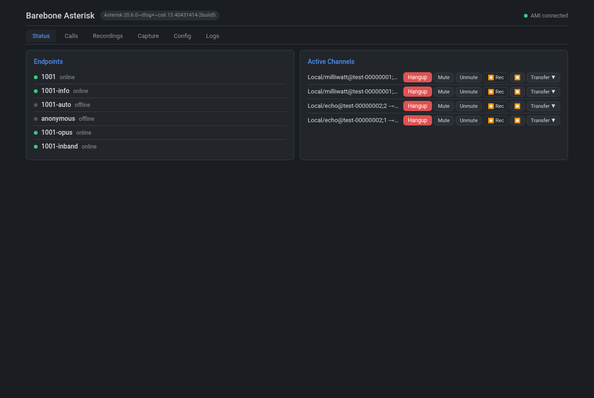
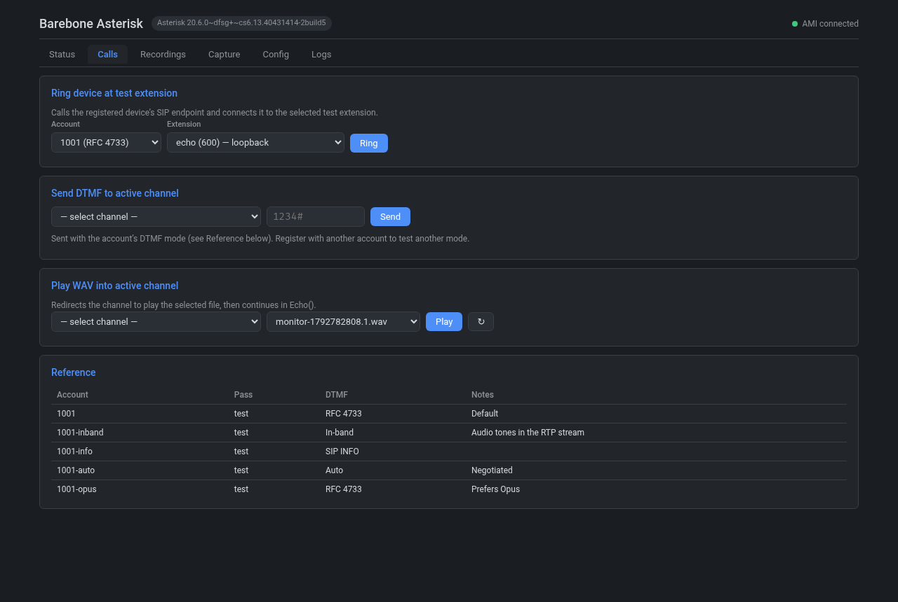
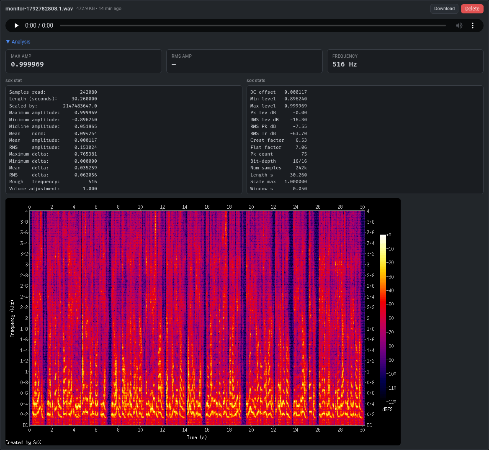
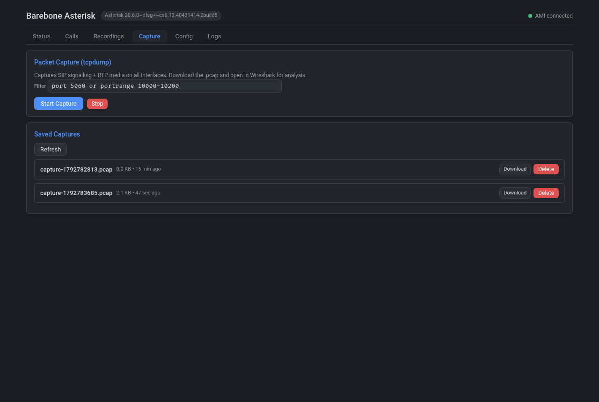
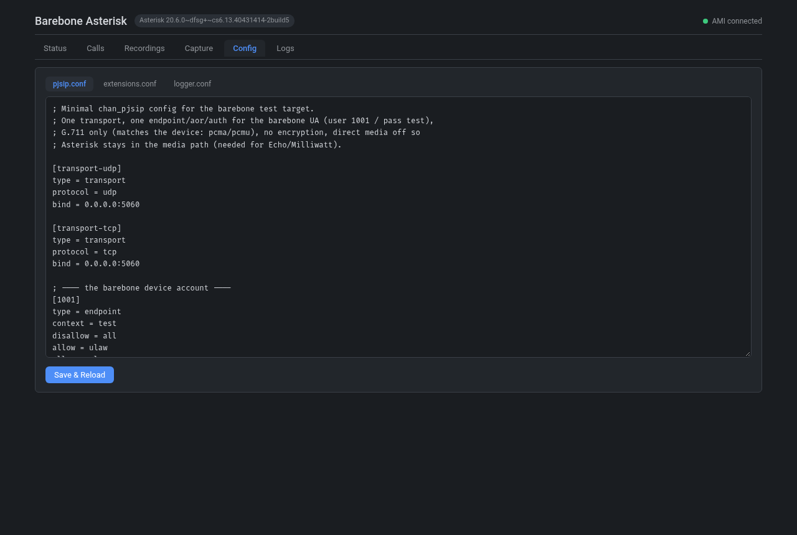
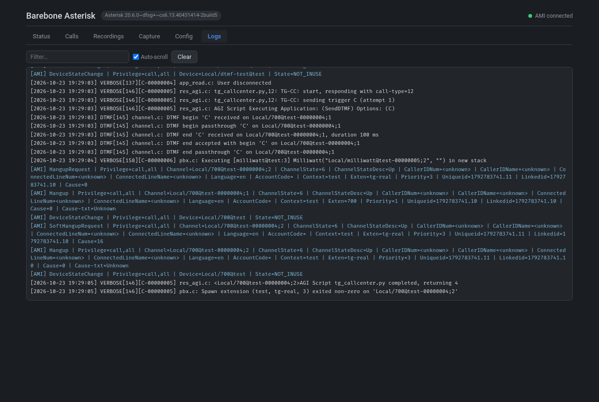

# Dockerized SIP test target (Asterisk)

A self-contained "call centre" for testing a SIP device or softphone. It answers
with known, repeatable audio so you can attribute echo, level drift, AGC
pumping and clicks to the device's audio chain rather than the network or the
far end.

Parts:

- `barebone-asterisk`: Asterisk 20 with test extensions and AGI call-centre simulators.
- `barebone-webui`: browser UI for call control, DTMF, WAV playback, recording, sox analysis and packet capture.
- `client/`: a baresip softphone in Docker, so you can call the server from this computer with a headset.

## Requirements

- Linux (or WSL2) with Docker and Docker Compose v2. BuildKit is required (default in recent Docker).
- Free host ports: `5060` udp/tcp (SIP), `10000-10200/udp` (RTP), `8087` (web UI), and on
  127.0.0.1 only: `5038` (AMI), `8088` (ARI).
- A SIP client to test with: your device, the bundled headset client (below), or any softphone.
- For the headset client: PulseAudio or PipeWire (with `pipewire-pulse`), `pactl` for `./run.sh devices`.

## Start

```bash
./run.sh           # build if needed, start, print the web UI / SIP addresses
./run.sh stop
```

| Command | Does |
|---|---|
| `./run.sh` / `./run.sh start` | Build images if missing, then start |
| `./run.sh build` | Rebuild images (after changing files), then start |
| `./run.sh restart` | Stop, then start |
| `./run.sh status` | Container state + access info |
| `./run.sh logs` | Follow container logs |
| `./run.sh stop` | Stop and remove the containers |
| `./run.sh call [ext] [account]` | Call the server with your headset (default `echo`, `1001`) |
| `./run.sh devices` | List audio devices for the headset client |

`run.sh` wraps `docker compose`, so `docker compose up --build -d` works too.

Both containers use host networking, so Asterisk listens directly on the host IP.

Web UI: `http://<host-ip>:8087`

## Quick test with your headset

All from this folder, in one terminal. The server runs in the background, so
the terminal is free once `./run.sh` returns.

1. Start the server:

   ```bash
   ./run.sh
   ```

2. Find your headset's device names:

   ```bash
   ./run.sh devices
   ```

   ```text
   Outputs (AUDIO_OUT):
     alsa_output.pci-0000_00_1f.3.analog-stereo
     alsa_output.usb-C-Media_Electronics_Inc._USB_Audio_Device-00.iec958-stereo
   Inputs  (AUDIO_IN):
     alsa_input.pci-0000_00_1f.3.analog-stereo
     alsa_input.usb-C-Media_Electronics_Inc._USB_Audio_Device-00.mono-fallback
   ```

3. Call the echo extension with the headset (the first call builds the client
   image, which takes a minute):

   ```bash
   export AUDIO_OUT=alsa_output.usb-C-Media_Electronics_Inc._USB_Audio_Device-00.iec958-stereo
   export AUDIO_IN=alsa_input.usb-C-Media_Electronics_Inc._USB_Audio_Device-00.mono-fallback
   ./run.sh call echo
   ```

   Talk: you hear yourself back about a second later. Skip the two `export`
   lines if the headset is already your default device.

4. Press `b` to hang up and `q` to quit the client. Then try other
   extensions; each call is a new `./run.sh call`:

   ```bash
   ./run.sh call milliwatt     # steady 1004 Hz tone
   ./run.sh call dtmf-test     # after the beep press 4 digits, it reads them back
   ./run.sh call record        # echo + recording, then open Recordings in the web UI
   ```

   While a call is up it shows in the web UI under Status.

5. Stop the server:

   ```bash
   ./run.sh stop
   ```

## Register a client

| Account | Password | DTMF mode |
|---|---|---|
| `1001` | `test` | RFC 4733 (RTP events), default |
| `1001-inband` | `test` | In-band audio tones |
| `1001-info` | `test` | SIP INFO |
| `1001-auto` | `test` | Auto-detect |
| `1001-opus` | `test` | RFC 4733, prefers Opus |

- Registrar / domain: `<host-ip>`, port `5060`, UDP or TCP.
- Codecs: G.711 µ-law/A-law (Opus on `1001-opus`).
- Anonymous direct-IP calls are also accepted, no registration needed.

## Headset client reference

```bash
./run.sh call                    # sip:echo@<host-ip> as 1001
./run.sh call milliwatt          # any extension from the table below
./run.sh call dtmf-test 1001-info  # extension + account (DTMF mode)
```

The first run builds the `sip-test-client` image (Debian + baresip). The
container uses host networking and plays/records through your PulseAudio or
PipeWire session. It uses SIP port `5070` and RTP `20000-20100`, so it can run
on the same machine as the server.

In the call:

| Key | Does |
|---|---|
| `0`-`9` `*` `#` `A`-`D` | Send DTMF |
| `b` or `Esc` | Hang up |
| `d` | Dial another URI |
| `q` | Quit |

Pick the headset if it isn't the default device:

```bash
./run.sh devices
AUDIO_OUT=alsa_output.usb-...  AUDIO_IN=alsa_input.usb-...  ./run.sh call
```

To call a server on another machine: `SERVER=192.168.1.50 ./run.sh call`.

## Test extensions

Dial `sip:<ext>@<host-ip>`, or use the numeric alias.

| Extension | Alias | What it does | Use it for |
|---|---|---|---|
| `echo` | `600` | Loops your audio back | Echo, AEC |
| `milliwatt` | `601` | Constant 1004 Hz 0 dBm0 tone | Level stability, AGC, clicks |
| `tone` | `602` | Dial tone for 30 s | Steady reference |
| `dtmf-test` | `603` | Reads 4 DTMF digits, says them back | DTMF mode end-to-end |
| `record` | `604` | Records the call while echoing | Offline analysis (WAV in `/tmp/sip-test`) |
| `opus-echo` | `605` | Echo, negotiates Opus if offered | Opus path |
| `playfile` | `606` | Plays a WAV, then echoes | Used by the web UI playback |
| `silence` | — | 5 s silence, then a tone | Comfort noise, silence gating |
| `speak` | — | Asterisk demo prompt | Speech intelligibility |

### Alarm protocol call-centre simulators

AGI scripts in `asterisk/agi/` act as the call centre for elevator alarm
protocols. The device drives the exchange after the call connects.

| Extension | Alias | Protocol |
|---|---|---|
| `tg-real` | `700` | Telegärtner, emergency (call type 12) |
| `tg-tech` | `701` | Telegärtner, technician (13) |
| `tg-routine` | `702` | Telegärtner, routine test (14) |
| `tg-routine2` | `703` | Telegärtner, routine test (22) |
| `p100-real` | `704` | P100, acknowledge + voice phase |
| `p100-routine` | `705` | P100/EOX routine handshake (N → N+1 → N+2) |

The protocol steps are documented at the top of each script.

## Web UI

| Tab | What it does |
|---|---|
| Status | Registered endpoints; active channels with hangup, mute, record, transfer to a test extension |
| Calls | Ring a registered account at any test extension, send DTMF, play a WAV into the call |
| Recordings | List, play, download, delete call recordings; spectrogram and sox stats; upload WAVs for playback |
| Capture | Start/stop tcpdump on SIP and RTP ports, download `.pcap` |
| Config | Edit `pjsip.conf`, `extensions.conf`, `logger.conf` and reload Asterisk |
| Logs | Live Asterisk log and AMI event stream |

- Recordings, uploads and captures go to `/tmp/sip-test` on the host
  (set `SIP_TEST_DIR` to change it). Files are created by root inside the
  containers.
- DTMF from the web UI uses the channel's `dtmf_mode`. To test another mode,
  register with the matching account.
- Mute silences the call audio in both directions (Asterisk has no AMI hold action).
- Config edits are written to the files in `asterisk/` and applied with
  `core reload`. You can also edit those files directly and reload.

### Status

Registered accounts and active calls.



### Calls

Ring a device, send DTMF, play a WAV into a call.



### Recordings

Recording analysis: sox stats and spectrogram.



### Capture



### Config



### Logs

Asterisk log lines (white, warnings in orange) and AMI events (blue). Here a TG
call-centre simulation on extension 700 sends the trigger `C`.



## Check from the command line

```bash
docker exec -it barebone-asterisk asterisk -rx "pjsip show endpoints"
docker exec -it barebone-asterisk asterisk -rx "core show channels"
docker logs -f barebone-asterisk
```

## macOS / Windows Docker Desktop

Host networking does not pass RTP through the Docker VM. Switch both services
to bridged networking:

- Publish `5060/udp`, `5060/tcp`, `10000-10200/udp`, `8087/tcp`.
- In `asterisk/pjsip.conf`, set `external_media_address` and
  `external_signaling_address` on the transports to the host IP.
- Point the web UI at Asterisk by service name (`ASTERISK_AMI_HOST=asterisk`,
  `ASTERISK_ARI_URL=http://asterisk:8088`), and change `bindaddr` in
  `asterisk/manager.conf` and `asterisk/http.conf` from `127.0.0.1` to `0.0.0.0`
  (and `permit` in `manager.conf`).
- The headset client also needs host networking, so run it natively on those systems.

## Security

SIP credentials (`test`) are fixed, anonymous calls are allowed, and the web UI
has no login. AMI and ARI listen on 127.0.0.1 only. Run this on a trusted lab
network.

## License

Copyright (C) 2026 Eduardo Correia

This program is free software: you can redistribute it and/or modify it under
the terms of the GNU General Public License version 3 as published by the Free
Software Foundation. See [LICENSE](LICENSE).
